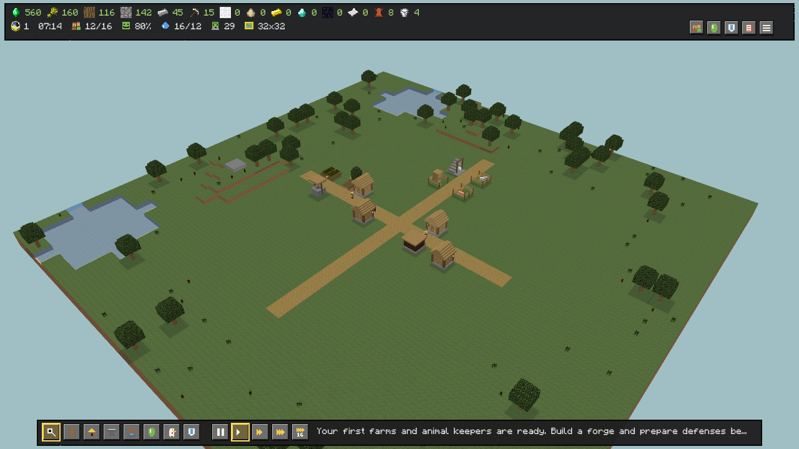
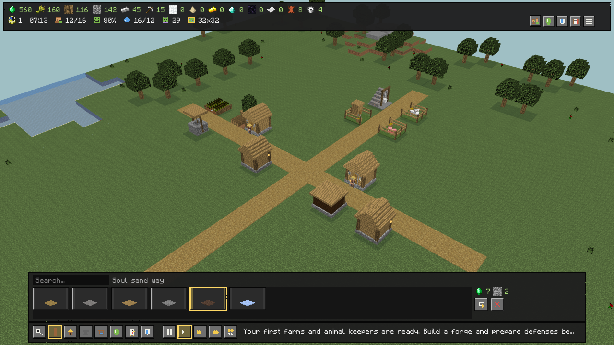
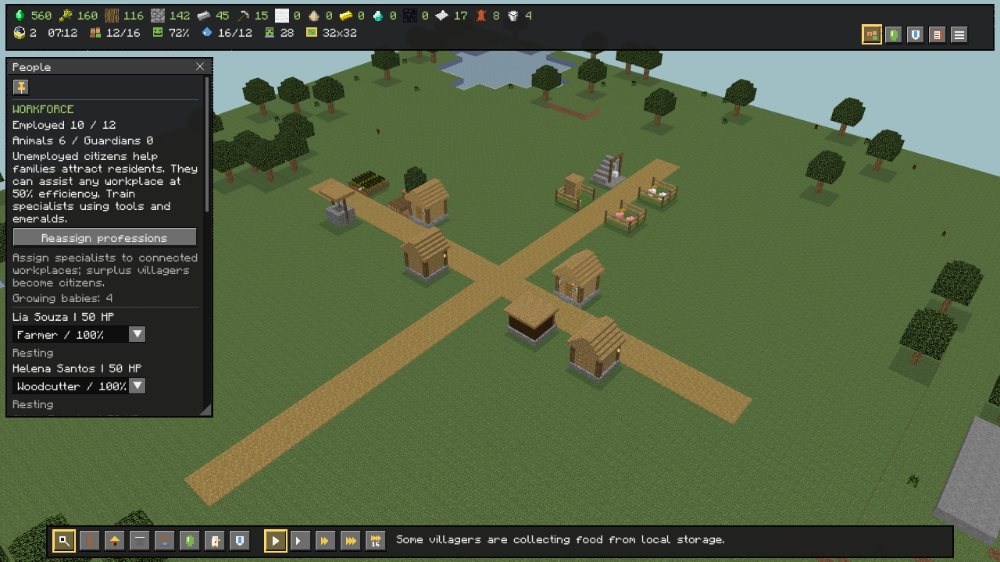
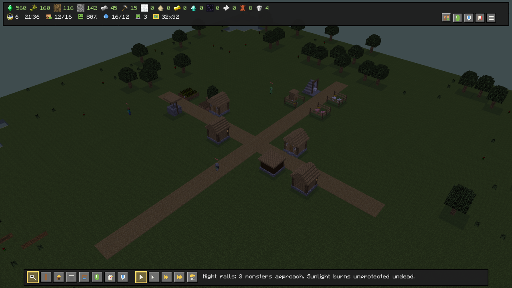
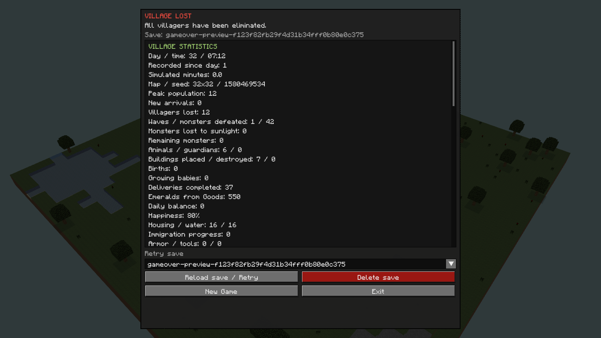

# VillageCraft — The Living Overworld

A 3D village builder in C#, combining Minecraft-inspired villages with city management. Place complete buildings, organize workers and supplies, and defend a growing settlement.

> **Unofficial fan-made project.** Not affiliated with, endorsed by, or an official product of Mojang Studios or Microsoft. Minecraft and its assets belong to their respective owners.

**Development:** GPT 6.1 Sol works on game code and logic. The repository owner guides development through prompts and acts as QA, testing and validating changes.

## Build a living village

- **Build with prefabs:** connect homes, farms, workshops and defenses with roads.
- **Manage a working economy:** assign professions, deliver supplies, store resources and trade for emeralds.
- **Care for residents:** balance food, water, housing and happiness; inspect villagers and use the yellow exclamation button to review grouped city problems.
- **Hear the village:** Minecraft creature voices, material footsteps, workplace effects and settlement/raid alerts, with speed-safe playback limits.
- **Survive the night:** protect the village with defenders and golems against regular encounters and boss waves.
- **Make it your own:** customize TOML content and JavaScript behaviors with editor type definitions.

The interface supports Brazilian Portuguese by default and English, with adjustable UI scale and display settings. Windows is tested; Linux and macOS remain targets requiring validation. The game is in active beta development, so save formats may change.

## Screenshots

Captured in-game with separately supplied Minecraft 1.16 assets. The screenshots show the English interface.

**Village overview**



**Building and road selection**



**Villager management**



**Night encounters**



**Save statistics after defeat**



## Run the game

Requires **.NET 10 SDK**, **OpenGL 3.3**, and separately supplied Minecraft assets. Development uses **Minecraft Java 1.16 textures and sounds**, which are **not included in this repository**. The custom UI uses `mojangles.ttf` when supplied; otherwise it falls back to a system font, then ImGui's built-in font.

Extract textures into the root `textures/` folder, preserving paths such as `textures/entity/piglin/piglin.png`. Alternatively, point `VILLAGECRAFT_ASSETS` to your external asset directory; indexed assets are also supported.

From the repository root:

```sh
dotnet run --project VillageCraft -c Release
```

PowerShell users can also run `./run.ps1`.

Saves, options and logs live in `UserData/` beside the executable. Used Minecraft assets are cached in `UserData/cache.zip`; delete it while the game is closed to refresh changed textures. External assets are read directly without copying their folders on every build.

## Controls

**WASD** pans, **Q/E** rotates, **Shift** rotates faster, and the **mouse wheel** zooms. Click to inspect or build; **R** rotates a prefab. **Space** pauses, **1–4** changes speed, and **Esc** opens the save/load and options menu.

Press **F3** for the [performance profiler](VillageCraft/Content/PROFILING.md), including script callbacks, pathfinding, rendering, allocations and CSV exports.

## Modding

Buildings, professions, models and balance use editable TOML files. JavaScript components control villager, enemy and building behavior through Jint.

- [Content guide](VillageCraft/Content/README.md)
- [JavaScript API](VillageCraft/Content/SCRIPTING.md)
- [Editor type definitions](VillageCraft/Content/game.d.ts)
- [Audio guide](VillageCraft/Content/AUDIO.md)
- [Localization guide](VillageCraft/Content/Locales/README.md)
